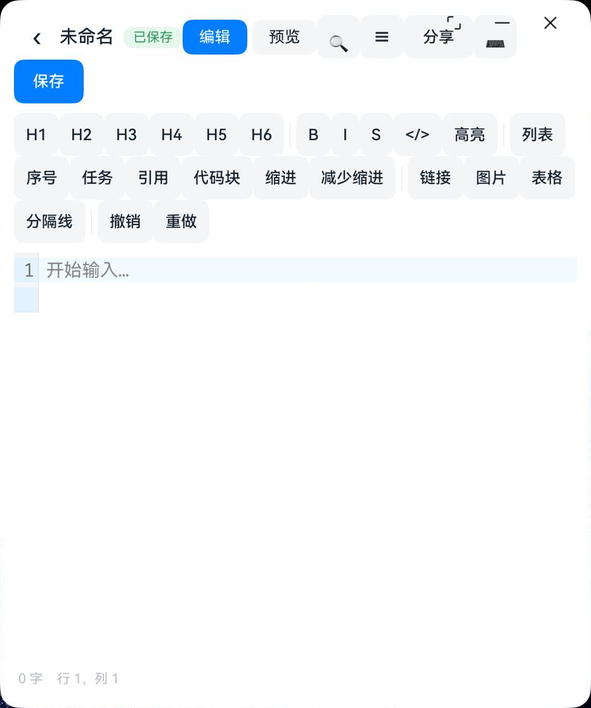
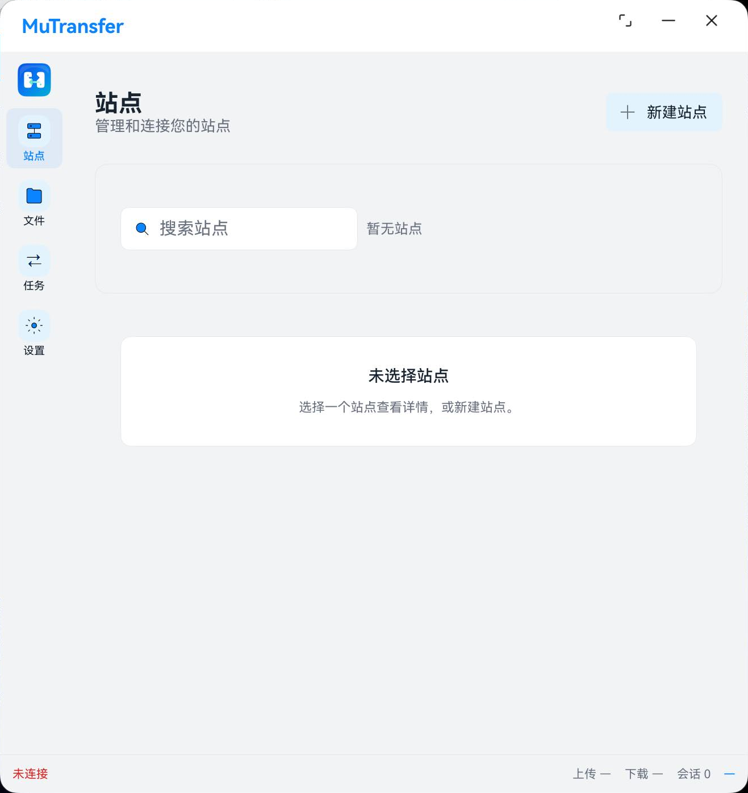

# Harmony Markdown Workbench 功能与布局整改方案

日期：2026-10-15  
源码基线：`main`，`e643ee2`，V0.4.3  
参考项目：本地 `ftp`，产品名称 MuTransfer  
状态：待实施。本文件记录改造方案与验收要求，不表示代码已修改或用例已通过。

## 1 目标与范围

本轮优先解决保存可靠性、窗口适配和文件操作闭环。保留 ArkUI、ArkWeb、CodeMirror 6、markdown-it 现有技术路线，不重写编辑器，也不引入账号、云同步或 AI 写作。

用户已明确提出“最近列表可以收起来”。本方案将其落实为可折叠文档侧栏：首页和编辑页共用，支持手动开关、记忆选择，并在空间不足时临时折叠。

实施分四批：

1. A 批：保存、草稿、冲突和快照错误处理。
2. B 批：统一工作台外壳、折叠侧栏、工具栏、大纲和分屏适配。
3. C 批：另存为、图片、回收站、固定、快捷键和文件分享。
4. D 批：长文联动、预览高亮与按需扩展。

P0 为可能导致内容丢失、错误覆盖或错误显示保存成功的问题；P1 为主要使用流程与布局问题；P2 为增强体验。新增能力属于范围建议，不应与现有版本的缺陷混为一谈。

## 2 检查依据与证据范围

本轮已在 MateBook Pro，OpenHarmony 7.0.0.106，API 26 上检查首页窄窗、首页宽屏、首页中等窗口、空白编辑页、窄窗工具栏和大纲，以及 FTP 空站点页。保存并发与首次防抖问题使用实际领域代码转译后进行最小复现，不等同于完整 ArkTS 构建或真机保存测试。

证据分为：

- **实测**：本轮真机截图或实际逻辑最小复现。
- **代码确认**：已定位实现中的缺口或处理分支，完整用户流程仍需回归。
- **待验证**：由代码提出的风险，需要专项测试确认影响。
- **新增能力**：现有实现未覆盖，需按本方案实现后验收。

### 2.1 首页中等窗口

窗口宽 1317 物理像素，按界面几何约为 693vp。固定侧栏与最近列表占去大部分宽度，欢迎标题和三个入口卡片严重挤压。不要将物理像素值直接用于 ArkUI 断点。


### 2.2 窄窗编辑器

窗口宽 932 物理像素，按界面几何约为 491vp。保存按钮换行，格式工具占三行，应用动作与系统窗口控制区靠得过近。开启固定宽度大纲后，正文进一步缩窄。



### 2.3 FTP 同宽参考

FTP 在相同的 1317 物理像素窗口宽度下使用窄导航栏，内容没有被三个固定栏挤坏。截图为未配置站点状态，只用于结构和空间分配参考，不代表其完整业务流程已验收。



### 2.4 尚未覆盖的验证

尚未完成长文、中文 IME、软键盘遮挡、读屏、完整键盘导航、后台与系统关窗、断电或进程终止场景的专项验收。相关要求在下文列为待执行用例，不能标记为已通过。

## 3 问题总表

| 编号 | 优先级 | 问题或能力缺口 | 证据 | 对应任务 |
|---|---|---|---|---|
| R01 | P0 | 保存中继续输入，完成时仍清除待保存状态 | 最小复现 | A1 |
| R02 | P0 | Web 调用失败被转换成空字符串，空正文与读取失败不可区分 | 代码确认，误写风险待真机验证 | A1 |
| R03 | P0 | 外部文件写入忽略 expectedRevision，直接截断写入 | 代码确认 | A2 |
| R04 | P0 | 保存并离开不检查保存结果；草稿提示与实际检查点不一致 | 代码确认 | A3 |
| R05 | P0 | 新建文档没有目标时跳过草稿；草稿写入自身使用截断覆盖 | 代码确认，崩溃影响待验证 | A3 |
| R06 | P1 | 首次输入不满足预期的 1.5 秒防抖 | 最小复现 | A1 |
| R07 | P1 | 编码、换行与字节长度元数据未形成完整读写契约 | 代码确认，文件结果待验证 | A4 |
| R08 | P1 | 外部访问失效和打开失败缺少明确恢复状态 | 代码确认 | A2 |
| R09 | P1 | 首页非窄窗强制三栏，最近不可折叠，入口重复 | 真机实测、代码确认 | B1、B2 |
| R10 | P1 | 首页和编辑页外壳割裂，切换文档需要退出编辑页 | 代码确认 | B1 |
| R11 | P1 | 顶栏和完整工具栏靠换行适配，侵占正文 | 真机实测 | B3 |
| R12 | P1 | 大纲固定 200vp，分屏没有按剩余宽度决策 | 真机实测、代码确认 | B4 |
| R13 | P1 | 宽屏正文居中而行号位于最左，定位关系不协调 | 真机实测 | B4 |
| R14 | P1 | 普通另存为、原文件导出和文件分享入口不完整 | 代码确认、新增能力 | C1 |
| R15 | P1 | 图片只插入示例 URL，缺少本地附件链路 | 代码确认、新增能力 | C2 |
| R16 | P1 | 回收站缺少恢复入口，固定文档缺少操作入口 | 代码确认 | C3 |
| R17 | P1 | 缺少原生应用命令与 Web 编辑器一致的快捷键绑定 | 代码确认、新增能力 | C4 |
| R18 | P2 | 缺少同步滚动；大纲正则不处理代码围栏和 Setext 标题 | 代码确认 | D1 |
| R19 | P2 | 预览缺少代码块语言高亮 | 代码确认、新增能力 | D2 |
| R20 | P2 | 低对比文字、纯符号按钮和状态反馈需要统一 | 截图观察，读屏待验证 | B3、D3 |
| R21 | P2 | PDF、公式、Mermaid、多标签和目录工作区 | 新增能力 | D4 |

## 4 A 批 数据可靠性

### A1 修复快照契约与保存调度

**涉及文件**

- `entry/src/main/ets/services/SaveCoordinator.ets`
- `entry/src/main/ets/domain/recovery/SaveStateMachine.ets`
- `entry/src/main/ets/domain/recovery/SaveScheduler.ets`
- `entry/src/main/ets/pages/EditorPage.ets`
- `web-tools/src/editor.js`
- `entry/src/main/ets/domain/bridge/BridgeProtocol.ets`
- `entry/src/main/ets/services/EditorBridge.ets`

**具体改法**

1. Web 编辑器维护单调递增的编辑版本。用户输入、撤销重做和工具栏修改正文均递增版本；加载其他文档创建新的会话标识，不能复用旧文档的版本与异步结果。
2. 快照接口一次性返回 `{ sessionId, editVersion, content }`。内容与版本必须来自同一次编辑器状态读取，不能通过两次异步调用拼接。
3. 原生 JS 调用返回明确的成功或失败结果。区分合法空字符串、Web 未就绪、执行失败、超时、协议或会话不匹配；禁止以空字符串代替失败。
4. 保存串行执行。保存某个版本期间发生新编辑，应保留 dirty 状态；写入完成只能确认该版本，不能无条件清空 pending。必要时重新取快照核对最新版本，不能只依赖可能延迟到达的编辑通知。
5. `saveNow()` 返回明确结果，如 saved、unchanged、conflict、failed；同一会话中并发的手动保存应等待或合并到同一个保存队列，不能把“未执行”当成功。
6. 调度器在首个待保存编辑到来时初始化周期：停止输入 1500ms 后触发；连续输入最长 10000ms 触发一次。使用真实时间戳和从零开始的虚拟时钟都必须正确。
7. 保存失败保留正文与检查点。自动重试采用有上限的退避，避免 500ms 轮询不断写入或不断弹错；用户手动重试可立即执行。

**验收点**

- A1-01：以 `Date.now()` 数量级的时间戳首次编辑，1499ms 前不保存，1500ms 后进入可保存状态；允许轮询引入一个轮询周期的实际执行延迟。
- A1-02：连续输入超过 10 秒，触发一次保存或检查点；新周期继续按规则调度。
- A1-03：写入旧快照时插入新字符，旧写入完成后不能显示最新内容已保存；后续保存最终与编辑器最新正文一致。
- A1-04：同时触发自动保存、Ctrl+S 和按钮保存，同一文档不存在重叠写入。
- A1-05：空白文档快照成功允许保存为空；模拟 Web 错误、超时和未就绪时原文件字节保持不变。
- A1-06：切换文档后，旧会话快照或写入回调不能更改新文档标题、状态或正文。
- A1-07：连续写入失败时保留草稿，重试频率受控；恢复可写后可以手动成功保存。

**测试落点**：扩展 `SaveCoordinator.test.ets`、`SaveScheduler.test.ets`、`BridgeProtocol.test.ets`；新增真实版本号和延迟依赖测试。真机验证中文输入、撤销重做及工具栏操作期间的自动保存。

### A2 补齐外部文件冲突和访问失效处理

**涉及文件**：`ExternalUriFileSource.ets`、`DocumentFileAdapter.ets`、`FileRevision.ets`、`EditorPage.ets`、`HomePage.ets`。路径分别位于 `infrastructure/file`、`domain/document` 和 `pages`。

**具体改法**

1. 外部文件写入前重新读取当前内容，按统一解码和哈希规则与打开时的基线比较。检测到变化时返回 conflict，禁止先 TRUNC 再判断。
2. 冲突界面明确提供“读取磁盘版本”“另存本地副本”“继续保留本地编辑”。继续保留本地编辑不应恢复自动覆盖原文件；只有用户解决冲突、另存成功或明确选择覆盖当前已核对版本后，才能恢复该目标的保存。
3. 若增加“覆盖磁盘”操作，需展示这是显式覆盖；执行前再次检查版本，变化时重新提示。检查与写入之间仍有竞争窗口，不能宣称外部 URI 写入是原子事务。
4. 在平台不支持原子替换的外部 URI 上，必须先可靠落草稿，再尝试原位写入；写入、同步、关闭失败时保留恢复入口。不能只凭 open 成功显示已保存。
5. 所有文件描述符在 finally 中关闭；检查完整读取和完整写入结果，处理部分读写。
6. 增加文档 loading、ready、loadFailed、accessExpired 状态。加载成功前禁止写回；访问失效提供重新选择文件、另存副本、返回三条路径。
7. 重新选择文件后重新建立来源、版本基线和显示名，不依赖旧 URI 自动恢复持久权限。新位置无法确认是原文件时不静默绑定。

**验收点**

- A2-01：应用打开文件后，用其他应用修改再保存；出现冲突，磁盘修改不被静默覆盖。
- A2-02：冲突后选择继续本地编辑，等待自动保存周期，原文件仍保持磁盘版本。
- A2-03：另存副本成功前不得删除本地草稿或把状态标记为已保存；失败可以重试。
- A2-04：权限失效、文件删除、文件读取失败均显示明确状态，不呈现可正常保存的空白文档。
- A2-05：模拟写入失败或部分写入，保留完整本地快照和恢复入口；不得显示保存成功。
- A2-06：设备重启后尝试最近列表中的外部文件，失效时可重新选择并恢复操作，不循环报错。
- A2-07：重复打开与失败重试，不持续增加未关闭的文件描述符。

### A3 独立草稿和统一离开流程

**涉及文件**：`EditorPage.ets`、`DraftStore.ets`、`DraftDecision.ets`、`RecoveryPage.ets`、`EntryAbility.ets`，以及 A1 的保存服务。

**具体改法**

1. 新建文档立即生成独立会话文档 ID，不等待第一次保存到资料库后才拥有草稿身份。保存或重命名时迁移草稿关联，确认迁移成功后再清理旧条目。
2. 将恢复检查点与原文件自动保存解耦。关闭自动保存只停止原文件自动写回，恢复检查点继续工作，并在设置说明中明确。
3. 建议检查点采用输入停止 500ms、防抖最长 2 秒；该值为初始实现参数。界面不得承诺尚未落盘的字符已经恢复保护。进程被强制终止只能保证恢复最近一次成功检查点。
4. 草稿采用临时文件写入、同步、原子替换的方式；不能在每次更新时直接截断唯一有效草稿。正文与会话版本一同保存。
5. 实现统一 `requestLeave()` 流程，供返回、切换文档和平台允许拦截的关窗路径复用。保存成功且无新编辑才离开；失败留在页面，提供重试、另存为和取消。
6. 离开提示中的“草稿已保留”必须以成功保存当前检查点为前提；失败时明确告知。将“放弃”改为明确动作，区分“放弃修改”和“保留草稿后离开”。
7. 进入后台按生命周期能力尽力刷新检查点；不能把不可保证完成的终止回调作为唯一保护。实际系统关闭行为需要真机验证后记录。

**验收点**

- A3-01：新建文档首次保存前输入，成功生成检查点后终止应用，恢复页能找到内容。
- A3-02：关闭自动保存并输入，原文件不自动改变；检查点成功后重新启动可以恢复。
- A3-03：选择保存并离开，模拟磁盘写入失败，页面保持打开且正文可继续编辑。
- A3-04：模拟检查点写入失败，提示中不出现“已保留”，旧有效草稿保持可读。
- A3-05：写临时草稿过程中终止应用，至少能读取上一个有效检查点，不能只剩损坏 JSON。
- A3-06：新建、自动命名升级、手动重命名、另存后，恢复页没有错误指向旧文件或重复遗留项。
- A3-07：返回、切换文档、后台和系统关窗分别实测，记录哪些路径可阻止离开、哪些依靠检查点恢复。

### A4 统一编码和版本元数据

**涉及文件**：`TextEncoding.ets`、`DocumentFileAdapter.ets`、`InternalFileSource.ets`、`ExternalUriFileSource.ets`、文档会话模型及 `EditorPage.ets`。

**具体改法**

1. 读取结果中的 encoding、lineEnding、validUtf8 进入会话模型。非法 UTF-8 默认阻止写回，提供重新选择或显式转换入口，不能静默按乱码编辑并覆盖。
2. 明确“编辑器规范化正文”和“磁盘字节”两层：编辑器使用 LF；保存时依据原编码补 BOM，依据原换行风格生成输出字节。
3. 修正写入 revision.size，使用 UTF-8 编码后的字节长度，不用 JavaScript 字符串 length。
4. 内外适配器的基线哈希使用同一规范。内容哈希与原始字节哈希若均需要，分字段保存，不能混用。
5. 内部适配器基线读取错误必须区分文件不存在和其他 IO 错误；不能把所有异常都当首次写入继续覆盖。

**验收点**

- A4-01：UTF-8、UTF-8 BOM、LF、CRLF 四种组合分别打开修改保存，保留约定的编码和换行。
- A4-02：中文、emoji、多字节字符保存后字节长度与文件 stat 一致。
- A4-03：合法 BOM 文件未被外部改动时不误报冲突。
- A4-04：非法 UTF-8 不允许静默覆盖；提示可读，原字节不变。
- A4-05：基线文件读取报权限错误时返回失败，不按新文件覆盖。

## 5 B 批 工作台和响应式布局

### B1 统一外壳与文档会话

**现有入口**：`HomePage.ets`、`EditorPage.ets`、`SettingsPage.ets`、`RecoveryPage.ets`、`Breakpoints.ets`、`EntryAbility.ets`。

**建议新增**：`components/workbench/WorkbenchShell.ets`、`WorkbenchNavigation.ets`、`DocumentSidebar.ets`、`domain/workbench/WorkbenchLayoutPolicy.ets`、`services/DocumentSession.ets`、`infrastructure/metadata/WorkspaceUiStore.ets`。名称允许按仓库约定调整，职责边界保留。

**具体改法**

1. 外壳负责导航、侧栏、主区和状态栏；DocumentSession 负责当前文档、版本、来源、保存与恢复状态。组件不能各自复制一套正文和保存状态。
2. 首页为没有活动文档时的欢迎主区；打开文档后由编辑主区替换欢迎主区，导航和侧栏保持稳定。第一阶段先支持一个活动文档，多标签不作为前置条件。
3. 侧栏包括“最近”“固定”“资料库”三个筛选入口，共用搜索和文档行。移除左侧重复的“最近数量”展示。
4. 切换文档必须经过 A3 离开流程，恢复该文档的光标与滚动位置；切换失败保持原文档，不提前切换选中状态。
5. 参考 FTP `features/shell/view/AppShell.ets` 的组合方式，和 `ui/layout/LayoutPolicy.ets` 的纯策略结构；复用思路，不复制 FTP 业务状态或其过时注释。

**验收点**

- B1-01：从最近列表打开 A，再切到 B，不必返回首页；标题、选中项、正文和保存目标始终对应同一文档。
- B1-02：保存失败时切换被阻止；完成另存或明确放弃后才切换。
- B1-03：设置、恢复页返回后，当前文档内容和布局状态保持，不重建为空文档。
- B1-04：宽窄切换不重复创建保存协调器，不重复注册键盘或桥接监听。

### B2 可折叠最近列表和空间策略

**具体改法**

1. 在统一顶栏放“显示文档侧栏 / 隐藏文档侧栏”按钮，提供可访问名称、悬浮提示和选中状态；首页与编辑页使用同一个按钮和状态源。
2. 区分用户偏好和实际展示：保存 `sidebarPreferredOpen`，由空间策略计算 docked、overlay、hidden。窗口缩小造成的自动折叠不覆盖用户偏好；重新放大后恢复。
3. 首次启动：宽屏默认展开，中等窗口默认收起，窄窗通过抽屉打开。用户之后手动调整以持久化偏好为准，但不能突破内容区最小宽度约束。
4. 抽屉覆盖主区，不挤压正文；支持关闭按钮、遮罩和 Esc。选择文档后窄窗关闭抽屉，焦点回到新文档。
5. 使用根容器 `onAreaChange` 获得实际 vp 尺寸；内容组件再测量自己的剩余空间。不要以设备类型或整块屏幕分辨率决定编辑区结构。
6. 初始几何建议：导航栏 64vp；停靠文档侧栏 260vp，可调 220–360vp；首页主区至少 360vp。含间距后不足时，侧栏改覆盖式或收起，不能继续挤压欢迎卡片。
7. 首页欢迎入口空间不足时改为纵向操作列表，不维持三个并排卡片；宽屏保留简洁空状态，避免与导航重复放置多套大型按钮。
8. 可将 <600vp、600–1199vp、>=1200vp 作为外壳初始档位；具体停靠和分屏仍由剩余空间决定。数值为待验证的设计初值，不是从 FTP 照搬的完成结论。

**验收点**

- B2-01：首次宽屏展开、首次中窗收起；手动关闭后重启仍关闭。
- B2-02：用户展开侧栏后缩小窗口，侧栏自动折叠；重新放大恢复用户展开偏好。
- B2-03：侧栏收起后主区填满，无空白占位或残留分隔线。
- B2-04：在 599/600、1199/1200vp 附近及连续拖动中，文字和按钮不被挤成竖条，输入焦点不丢失。
- B2-05：至少覆盖 360、480、600、693、840、960、1200、1440vp；截图记录实测 vp，不以物理像素替代。
- B2-06：抽屉 Esc、关闭、遮罩行为一致，键盘焦点不会进入遮罩后的不可见控件。

### B3 顶栏 工具栏和查找面板

**涉及文件**：拆分 `EditorPage.ets` 的 build 部分；建议新增 `EditorHeader.ets`、`FormattingToolbar.ets`、`FindReplacePanel.ets`，统一图标和动作组件。

**具体改法**

1. 顶栏使用标题弹性区和操作区，预留系统窗口按钮及安全区域；明确哪些区域负责拖动窗口。系统标题栏与自定义标题栏只能有一致的保留空间策略，不能靠隐藏调用成功与否碰运气。
2. 宽屏显示标题、保存状态、视图切换、保存与更多；窄窗保留侧栏、短标题、保存、更多，视图切换可移到独立受控行。
3. 工具栏建议为标题下拉 H1–H6、加粗、斜体、列表菜单、插入菜单、撤销重做。删除线、高亮、缩进等进入相应菜单；窄窗保持一行，可水平滚动，不能整组无限换行。
4. 常驻工具提供当前选区状态、禁用状态和说明。保留全部现有格式命令，不因收纳而丢失功能。
5. 查找与替换分为基础查找行和可展开替换行；窄窗收纳匹配选项，支持 Esc 关闭及 Enter/Shift+Enter 导航。不能让整个表单自然换成不受控的多行按钮墙。
6. 统一真实图标资源，替换混用的 emoji、字符图标；所有纯图标按钮补可访问名称和悬浮提示。错误除状态颜色外必须提供文字和可执行操作。

**验收点**

- B3-01：360–1440vp 内保存不意外掉到第二行，系统最小化、最大化、关闭区域无应用按钮遮挡。
- B3-02：窄窗格式栏保持一行，所有命令均可通过滚动或菜单找到并正常执行。
- B3-03：打开查找、替换和冲突条时，正文仍有可操作区域；极低高度使用收纳或滚动，不将正文压至零。
- B3-04：每个纯图标按钮有中文可访问名称；键盘能打开菜单、执行动作、关闭并返回编辑器。
- B3-05：光标和选区不因点击原生格式按钮丢失，中文组合输入期间不会被工具栏提前提交或破坏。

### B4 大纲 分屏和编辑区域

**涉及文件**：`ViewModePolicy.ets`、`EditorPage.ets`、`web-tools/src/editor.js`、`web-tools/src/preview.js`、`rawfile/web/preview.html`。

**具体改法**

1. 增加“用户偏好视图”和“实际可展示视图”的区别；空间不足临时从 split 退化到 edit 或用户当前活动侧，空间恢复后还原偏好，不覆盖设置。
2. 内容区初始最小宽度建议：编辑 320vp、预览 320vp、大纲 200vp，加分隔与内边距。只有预算满足时才并排；文档侧栏、大纲和分屏必须由同一个空间预算协调。
3. 大纲在窄窗为覆盖式面板，宽屏可停靠。选择标题后定位并将焦点返回编辑器；有预览定位能力时同时定位预览。
4. 分隔条支持拖动，比例夹在最小宽度约束内；记忆偏好比例，在较窄窗口自动限制实际比例。布局调整不能重载 Web 正文。
5. 编辑器行号与正文作为整体设置宽度和位置。单栏宽屏可以限制整个编辑内容容器宽度；分屏内避免重复居中造成过大留白。
6. 预览与编辑区使用一致的字号尺度、主题和滚动容器约定；处理软键盘和低高度窗口，避免底部状态栏遮挡光标。

**验收点**

- B4-01：切换侧栏和大纲后，任一可见编辑/预览面板不低于最小宽度；不满足时明确降级。
- B4-02：拖动分隔条正常；重新启动恢复偏好比例；缩小放大后正文、撤销栈和光标保持。
- B4-03：单栏宽屏行号紧邻正文；预览、编辑与分屏切换不出现空白 Web 面板。
- B4-04：软键盘显示时，光标可滚入可见区域；关闭键盘后布局恢复。
- B4-05：浅色、深色两种主题下分隔线、查找命中、选区和大纲选中项可辨认。

## 6 C 批 文件操作闭环

### C1 另存为 导出和分享

**涉及文件**：`EditorPage.ets`、`DocumentFileAdapter.ets`、文件适配器、`HtmlExporter.ets`；建议新增 `DocumentExportService.ets`，避免继续增加页面内平台 IO。

**具体改法**

1. 文件菜单区分“另存为 Markdown”“导出副本”“导出 HTML”“分享文件”“复制 Markdown”“复制 HTML”。另存为成功后切换活动目标；导出副本不切换目标。
2. 系统保存选择器确认目标后，使用 A1 成功快照写入并确认结果。取消不改变标题、保存目标、最近列表或保存状态；失败保留当前会话和草稿。
3. HTML 的渲染和 getHtml 必须按同一快照顺序等待完成，不能发起渲染后立即读取旧 HTML；预览处于隐藏或未就绪时也要有确定的导出路径。
4. 文件分享依据目标 SDK 可用能力实现。实际不支持时明确展示可用的导出与复制操作，不能将复制文本标记为已分享文件。分享前同样获取确定版本快照。
5. 文件名、编码、来源位置和临时授权状态使用用户可读描述；不要将长 URI 直接作为主要标题。

**验收点**

- C1-01：新文档可保存到指定位置，成功后标题、最近记录和后续保存目标一致。
- C1-02：另存取消与失败，原目标和原正文保持不变。
- C1-03：导出副本不改变当前保存目标；导出 HTML 紧接最新输入也包含最新内容。
- C1-04：空文档导出策略明确；隐藏预览或预览未加载时不错误导出旧正文。
- C1-05：系统文件分享或降级入口在目标设备验证，提示与实际结果一致。

### C2 本地图片和附件

**涉及文件**：`MarkdownCommands.ets`、编辑命令服务、预览运行时；建议新增 `AttachmentService.ets` 与附件访问适配器。

**具体改法**

1. 图片入口提供本地选择、粘贴图片和输入 URL；用户取消不插入占位图片地址。
2. 内部资料库文档使用明确的附件目录和稳定标识，插入可迁移的相对引用；同名附件自动避让，复制写入成功后才插入引用。
3. 外部文件不能假设已获得兄弟目录权限。可访问时写入用户授权目录；不可访问时提供授权目录或导入为资料库文档的明确选择，不能生成不可读的沙箱绝对路径。
4. 预览通过受控资源映射访问附件，不放开任意本地文件权限。建立附件大小、格式和失败提示策略。
5. 普通 Markdown 文件与附件包导出区分清楚；没有打包或嵌入图片时，HTML 只能承诺样式自包含，不能承诺所有资源离线可用。

**验收点**

- C2-01：本地选择、URL、粘贴三种来源分别验证；选择取消不改变正文。
- C2-02：中文、空格、同名图片可正常引用；重启应用、重命名文档后图片仍显示。
- C2-03：外部目录无权限时有可完成的替代操作，不留下坏引用。
- C2-04：附件导出后在应用外打开，按所选导出模式验证图片；缺失附件有明确提示。
- C2-05：大图片或不支持格式不导致页面卡死或正文丢失。

### C3 回收站 固定和资料库管理

**涉及文件**：`HomePage.ets`、`InternalFileSource.ets`、`RecentFileList.ets`、`MetadataStore.ets`；建议拆出 `LibraryService.ets` 和 `TrashSurface.ets`。

**具体改法**

1. 删除时使用唯一回收 ID 保存正文、原名、删除时间、原位置和附件关联，避免两次删除同名文档相互覆盖。
2. 提供回收站入口、恢复、永久删除和清空。恢复重名时让用户选择新名称或取消，不能静默覆盖当前文档。
3. 仅对明确关联且没有其他引用的附件执行清理。关闭活动文档、移入回收站、最近列表清理需要作为一致流程处理。
4. 最近/资料库菜单增加固定与取消固定，固定列表独立可见；固定不等于只读。同步修正最近列表的淘汰规则，保证固定项不因普通上限被静默淘汰。
5. 资料库增加按名称和时间排序。全文搜索保留当前防抖，但为较大资料库加入取消旧请求或版本过滤，避免旧结果覆盖新查询；性能不足再评估索引。

**验收点**

- C3-01：删除后可恢复正文与附件；连续删除两个同名文档都能独立恢复。
- C3-02：恢复目标重名时不会覆盖，取消后回收站条目不消失。
- C3-03：固定与取消固定在重启后保持，普通最近记录淘汰不会删除固定记录。
- C3-04：删除或重命名活动文档时，保存目标与最近列表不指向失效路径。
- C3-05：快速连续搜索只展示当前查询结果；点击结果打开正确文档并能定位命中。
- C3-06：永久删除、清空有明确二次确认和结果反馈；失败条目保留可见。

### C4 统一命令和快捷键

**涉及文件**：`EditorPage.ets`、`web-tools/src/editor.js`、`EditorBridge.ets`；建议新增命令注册模块供菜单、按钮和快捷键共用。

**具体改法**

1. 建立统一命令：保存、打开、查找、替换、侧栏、大纲、视图切换、格式化等；按钮和快捷键调用同一逻辑，不复制保存实现。
2. 优先绑定 Ctrl+S、Ctrl+O、Ctrl+F、Ctrl+H、Ctrl+B、Ctrl+I；撤销重做与 CodeMirror 保持一致。侧栏快捷键使用不冲突组合并写入帮助菜单。
3. 编辑器获得焦点时由 Web 转发应用命令；原生输入框聚焦时尊重其编辑快捷键。阻止重复触发，避免浏览器默认保存或双重查找面板。
4. 更新帮助内容并正确显示换行；所有对外列出的快捷键必须实际绑定并验证。

**验收点**

- C4-01：菜单、按钮和 Ctrl+S 执行一致的保存流程，每次只触发一次。
- C4-02：编辑器、查找输入框、文档列表分别聚焦测试，不吞掉应由输入框处理的快捷键。
- C4-03：中文 IME 组合输入期间不误触发格式命令、不破坏组合文本。
- C4-04：帮助中的每一个快捷键可复现，未实现的组合不写入帮助。

## 7 D 批 长文与增强体验

### D1 同步滚动和语义大纲

**涉及文件**：`HeadingOutline.ets`、`EditorPage.ets`、`web-tools/src/preview.js`、`web-tools/src/editor.js`。

1. 复用 Markdown token/解析结果生成大纲和源行映射，识别 ATX、Setext，跳过代码围栏中的伪标题，处理行内格式和重复标题。
2. 预览块绑定源行范围，以可见块和块内位置映射编辑侧与预览侧。不要只按全文滚动百分比同步。
3. 提供同步开关；使用来源标识或重入锁避免双向滚动循环；正文变更后合并刷新映射。
4. 预览标题点击和大纲定位使用稳定且唯一的锚点，定位后不意外切换到其他文档或重置滚动。

**验收点**

- D1-01：包含 ATX、Setext、重复标题、代码围栏和格式化标题的语料，大纲与预览一致。
- D1-02：混合图片、表格、长代码块的长文双向滚动能定位相应段落，无抖动和循环跳动。
- D1-03：关闭同步后两侧独立滚动；打开后按当前活动侧定位，不跳回文首。
- D1-04：连续输入和图片加载改变高度后，映射更新，主线程无持续高占用。

### D2 代码块语言高亮

在 markdown-it 的渲染链中接入经许可检查的离线高亮库，按实际需要打包语言。未知语言按转义纯文本显示，浅色深色主题同步。限制异常长代码块的高亮开销，不改变禁用原始 HTML 的安全策略。

**验收点**：已知语言正确高亮；未知语言不报错；`<script>` 等源码只显示不执行；导出 HTML 保留所承诺的高亮样式；大代码块可以降级显示。

### D3 主题 文案和状态反馈

统一 AppTheme 与 Web 主题的字号、文字层级、按钮状态和错误反馈。提供跟随系统主题选项时，需要真正订阅系统变化。保存结果、复制成功、权限失效等用户可见反馈不应只写日志。固定高度设置行需允许大字体下增高或换行。

**验收点**：两种主题无不可辨文字；系统主题选项行为与名称一致；200% 文本缩放或平台等价大字体下设置控件不重叠；错误信息包含可执行的下一步；读屏能读出控件名称、状态和当前选中项。

### D4 后续能力的边界

PDF/打印、数学公式、Mermaid、多标签和目录工作区暂不纳入 A–C 批的完成门槛。需要进入下一版本时分别立项，定义离线资源、导出一致性、性能和权限边界。AI、账号、云同步仍在本轮范围外。

## 8 跨任务依赖与实施顺序

| 顺序 | 任务 | 前置依赖 | 可交付结果 |
|---|---|---|---|
| 1 | A1 | 无 | 可靠版本快照、串行保存和正确调度 |
| 2 | A2、A3、A4 | A1 的结果契约 | 冲突、恢复、编码和错误处理闭环 |
| 3 | B1、B2 | A3 的切换/离开流程 | 可折叠最近侧栏和统一工作台 |
| 4 | B3、B4 | B1、B2 | 工具栏、大纲、分屏和低高度适配 |
| 5 | C1、C3、C4 | A 批、B1 | 文件另存、回收站、固定和统一命令 |
| 6 | C2 | C1 的文件/导出契约 | 图片和附件读写、迁移及导出 |
| 7 | D1–D3 | B4、C2 | 长文联动、语义一致性和界面完善 |

每个任务结束后更新 `docs/spec/acceptance.md`，记录需求、用例、结果和证据。同步修正 README 中过时的“下一步”、完成状态和功能承诺；未通过的用例不能用“已完成”覆盖。

## 9 验收执行方法

### 9.1 逻辑层

- 对版本并发、真实时间戳、防抖、错误快照、冲突决策、文档切换及恢复决策做有意义的单元测试。
- 延迟依赖必须可控制，确保能稳定重现“快照后继续输入”和“旧会话回调晚到”。
- 用文件适配器故障注入覆盖读取失败、部分写入、fsync 失败、重命名失败和权限失效，不只测试内存成功路径。

### 9.2 构建与 Web 资源

工程根目录执行现有命令，Windows PowerShell 中显式调用 `.bat` / `.cmd`：

```powershell
.\hvigorw.bat test --mode module -p product=default
.\hvigorw.bat assembleHap --mode module -p product=default
```

修改 Web 源码后，在 `web-tools` 内执行：

```powershell
npm.cmd ci
node build-web.js
```

检查生成的 editor/preview bundle 和 HTML 与提交源码一致。Hypium 验收同时检查测试日志中的断言失败，不能只依据 hvigor 退出码或 BUILD SUCCESSFUL；使用并维护仓库已有的 clean-build 门禁。

### 9.3 真机矩阵

| 维度 | 必测范围 |
|---|---|
| 窗口 | 360、480、600、693、840、960、1200、1440vp，断点左右各 1vp，连续缩放 |
| 高度 | 普通高度、320/480vp 低高度、软键盘展开 |
| 外观 | 浅色、深色、大字体，系统主题跟随如已实现 |
| 面板组合 | 侧栏开关、大纲开关、编辑/预览/分屏、查找/替换、冲突条 |
| 文档 | 空文档、中文、emoji、BOM、LF、CRLF、长标题、重复标题、代码围栏 |
| 内容规模 | 小文件、100KB、1MB，带图片/表格/长代码块 |
| 来源 | 内部资料库、外部 URI、失效 URI、删除后的文件 |
| 生命周期 | 返回、切文档、后台、系统关窗、强制结束后恢复、设备重启 |
| 输入 | 鼠标、物理键盘、触控、中文 IME、软键盘 |

无需穷举全部组合，但必须覆盖每个维度及高风险组合：窄窗＋软键盘＋查找、大纲＋分屏＋文档侧栏、长文＋连续输入＋自动保存、外部文件＋冲突＋另存、关闭自动保存＋新建文档＋终止后恢复。

### 9.4 证据与结果记录

验收记录至少包含：用例编号、源码提交、应用版本、设备/系统、实际窗口 vp、前置文档、步骤、预期、实际结果、截图或日志路径、通过/失败/阻塞。

截图应显示完整应用和目标状态；同宽比较使用相同 vp 与字体设置。性能报告说明设备、文件大小和测量方法，不用主观“流畅”代替数据。继续沿用产品规格的性能目标，条件不等价的结果分开记录。

## 10 发布完成条件

- 所有 P0 用例通过，并验证最新内容与磁盘、恢复草稿、保存状态之间的一致性。
- B1–B4 核心用例通过；最近列表可收起、可恢复，主区随之填满，中等窗口不再出现挤坏的第三栏。
- 窄窗顶栏和工具栏受控，系统窗口按钮不被遮挡，正文和光标可操作。
- C 批中承诺进入本版本的功能全部形成成功、取消、失败三条路径，并与菜单/帮助描述一致。
- 单测日志、Web bundle 一致性和 HAP 构建检查通过，真机矩阵有对应证据。
- 无尚未解释的数据覆盖、空正文误写、错误显示已保存或恢复入口失效问题。
- 尚未实现的 D 批能力明确标为后续，README 和验收文档不提前宣称完成。

## 11 本地源码参考

- Markdown 首页：`entry/src/main/ets/pages/HomePage.ets`
- Markdown 编辑页：`entry/src/main/ets/pages/EditorPage.ets`
- 保存编排：`entry/src/main/ets/services/SaveCoordinator.ets`
- 调度与状态：`entry/src/main/ets/domain/recovery/`
- 内外文件实现：`entry/src/main/ets/infrastructure/file/`
- 草稿与最近元数据：`entry/src/main/ets/infrastructure/metadata/`
- Web 编辑器和预览：`web-tools/src/editor.js`、`web-tools/src/preview.js`
- FTP 参考：`../ftp/entry/src/main/ets/ui/layout/LayoutPolicy.ets`
- FTP 参考：`../ftp/entry/src/main/ets/features/shell/view/AppShell.ets`
- FTP 参考：`../ftp/entry/src/main/ets/features/shell/view/ResponsiveNavigation.ets`
- FTP 参考：`../ftp/entry/src/main/ets/features/files/view/FileWorkspaceSurface.ets`

上述路径均以各自工程为基准；新增文件和接口为实施建议，需要在实现时与现有仓库约束一并确认。
