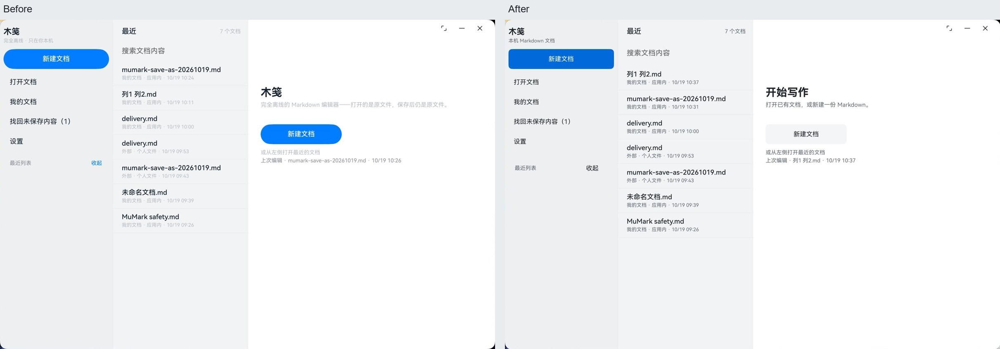
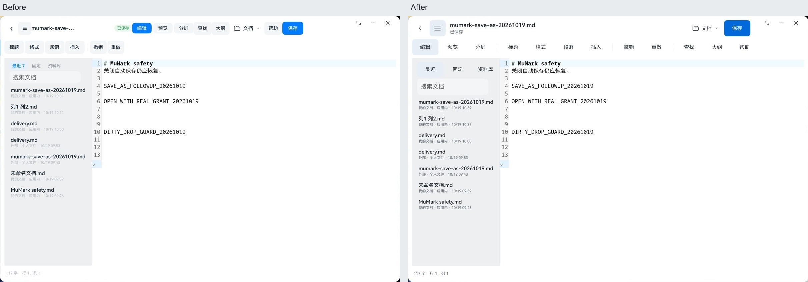
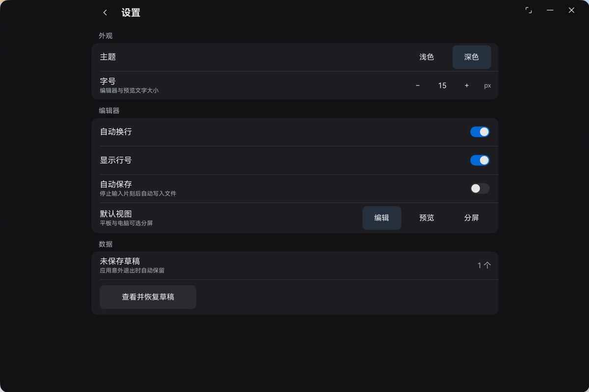
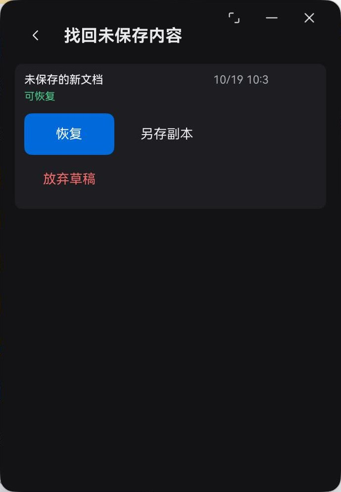
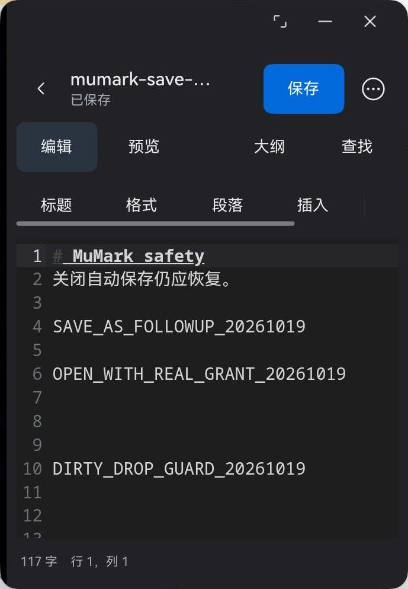
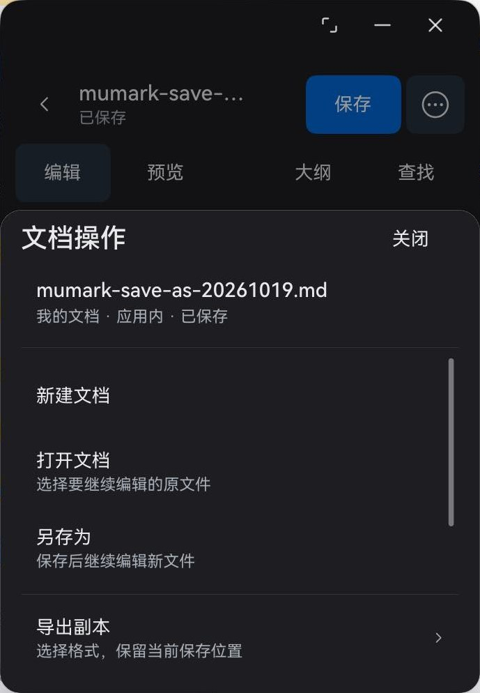

# 全局控件审查与验收

2026-10-19，TASK-CONTROLS-001，已实施；未验证项单列。[需求与设计](control-system-2026-10.md)。

## 审查范围与原始证据

目标：让同类操作同高、同色、同交互，并降低装饰性视觉干扰。设备 HAD-W32 / API 26，验证包 com.markdownworkbench.validation，窗口约 2089×1392px。以下是本轮新截图，均已打开检查；原件位于 `C:/Users/mu/harmonyos-screenshots/`。

1. 首页，screenshot_20261019_103011.jpeg：打开/最近路径清楚，但重复的大蓝胶囊抢占注意力，辅助文字过淡。
2. 编辑，screenshot_20261019_103115.jpeg：正文与原生菜单清楚；工具按钮、分段、文件入口高度及底色不同，标题区密集，侧栏筛选小于其他操作。
3. 设置，screenshot_20261019_103133.jpeg：分组与立即保存行为清楚；宽屏内容横跨全窗，恢复入口成为整条蓝胶囊，字号按钮及主题选择尺寸不一。
4. 恢复，screenshot_20261019_103149.jpeg：恢复/另存/放弃有区分；操作依赖系统默认高度，返回按钮和其他页不同。时间显示为 `10:3`，源码确认分钟未补零，并非实际字符串被布局裁切；窄窗操作存在挤压风险。

截图可见的小目标、低对比辅助文字和控件语义不一致属于可访问性风险；截图本身不能证明读屏、焦点顺序或 WCAG 全面合规。已有文档内容与草稿仅用于展示，不点击放弃或清理。

## 实施后验收

1. 首页：同类导航与主操作高 44vp，去掉双蓝胶囊，次要入口用中性色。重命名确认、关闭、更多等文字图标改原生 SymbolGlyph + Button。

2. 编辑：文件操作和命令分层，正常保存状态为普通辅助文字，标准按钮同高同宽，三键区留空。文档菜单和查找实际打开，正文仍为 117 字及原测试标记。

3. 设置：内容最大宽度 760vp，列表靠顶；恢复入口改普通按钮；主题、默认视图、字号与开关使用一致的主题规则。实际浅色切深色及窄窗滚动正常。

4. 恢复：操作宽 96vp、高 44vp，窄窗可换行，放弃草稿用危险色，返回使用原生图标；未点击放弃/恢复，保留已有草稿。图中时间为补零修正前的显示，最终源码已改为 `HH:mm`，该补充项仅构建检查，未重截恢复页。

## 原生尺寸与交互证据

使用 `hdc shell uitest dumpLayout -b com.markdownworkbench.validation -m false -a -p /data/local/tmp/mumark-controls-ui.json`，通过 hdc 拉回检查。connector 的全局 UI 树遇到其他应用深层节点时返回 depth exceeded，改为系统工具按包名限定；截图仍使用 connector，打开原件后才接受。

[原生测量](../ux/controls/measurements.json)：首页 7、编辑 19、设置 9、窄窗恢复 4 个应用标准按钮，均为 84px（当前密度下对应 44vp）；系统三键 53px 不纳入。编辑短标签按钮均为 137px（72vp），图标为 84×84px，恢复同组宽 182～183px（96vp 的像素取整差异），高均 84px。多行文件操作行按至少 56vp 单列，不伪称所有可点击行都是标准按钮。

宽窗约 2091×1394px；窄窗实际 689×994px（约 363vp 宽）。窄窗侧栏隐藏、标题省略、保存及操作入口正常，工具栏横向滑动后能看到撤销与重做；底部面板可滚动。以下均为本轮实际截图裁出应用区域，无界面修绘。

源截图：修改后首页 103858，编辑 103940，菜单 104009，查找 104036，窄窗设置 104245，深色与滚动 104324，恢复 104401，窄窗编辑 104445，底部面板 104458，横向滚动 104516，最终设置靠顶及按钮边距 104700。初次编辑截图 103706 显示“正在打开”，已拒绝，改用内容稳定的截图。最后 104718/104720/104731 被其他应用遮挡，已拒绝，不作为木笺证据。

## 命令与结果

环境：Windows PowerShell / DevEco JBR / SDK API 26，设备 3QC0124C11000711，HAD-W32。使用独立验证包升级安装，未删除或清空正式包及草稿。临时验证包名构建后已还原生产配置。

| 验证 | 结果 |
|---|---|
| `node scripts/test/test-host.cjs` | 228/228 通过，平台 IO 为 mock；验证保存和交付业务不替代原生授权 |
| `hvigorw.bat test --mode module -p product=default` | 最终源码 BUILD SUCCESSFUL，exit 0 |
| `hvigorw.bat assembleHap --mode module -p product=default -p buildMode=release` | 最终源码 BUILD SUCCESSFUL，exit 0 |
| `powershell -ExecutionPolicy Bypass -File build-logs/rebuild-validation.ps1` | Debug 构建、验证签名及主体交互运行通过；最终源码已再次构建并后台升级安装，没有切换设备前台 |
| `node scripts/check/check-docs.mjs` | 32 个 Markdown 文件 UTF-8 与本地链接检查通过 |
| `git diff --check` | 通过 |

## 需求结论与未验证项

- FR-CONTROLS-001/002：原生测量和深浅色截图通过；共享规则覆盖四页及侧栏。
- FR-CONTROLS-003：宽窗、689px 窄窗、设置滚动、恢复换行和工具栏滑动通过；最后恢复时间补零未重截。
- FR-CONTROLS-004：文档菜单、查找、主题及恢复入口点击通过；业务测试通过。完整 Tab 焦点遍历、读屏和本轮界面改动后的磁盘保存写回未重复真机验收，不声称全面可访问性合规。
- 设备上其他应用开始并行操作，最后停止前台点击。主题验收后当前保留深色，未抢占设备恢复浅色；不改动用户其他设置。
- 最后的代码排版、返回可访问标签和资料库行高微调已编译并安装，未再次前台操作；不把安装成功写成这些细节已再次实测。
- 只有 2in1 实机的 phone 宽度分支验收；真实手机键盘、安全区、横竖屏及其他系统版本未验收。
- 本轮无权限和包结构变更。目录工作区未实现，分包为后续设计选项；没有把授权或拆包写成已实现。
- Release 构建通过不等于原签名覆盖安装通过，设备使用独立验证包。

截图、测量为可复查证据，不以截图取代逻辑测试。构建日志在被忽略的 `build-logs/controls-*.log`，不入库。
